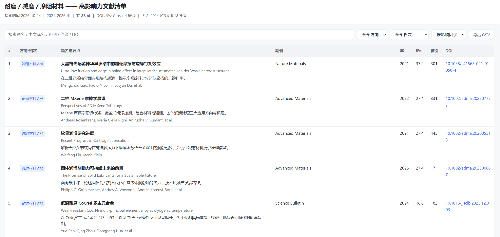

# lit-collection — WorkBuddy 文献整理 Skill

> 用一句自然语言需求，换回一套可直接交付的文献合集。

`lit-collection` 是一个 [WorkBuddy](https://www.workbuddy.cn/) Skill。它把「帮我整理 XX 方向近五年高影响力文献」这类需求，自动转成**真实学术数据库检索 → 去重打分 → DOI 核验 → 中文要点撰写 → 五件套导出**的完整流水线，最终产出可交互网页清单、中文报告、CSV 与参考文献导入文件。



---

## 它能做什么

| 交付物 | 说明 |
|---|---|
| `index.html` | 可交互网页清单：关键词搜索、方向/档次筛选、按影响因子/被引/年份排序、一键导出 CSV |
| `<主题>_文献检索报告.md` | 中文报告：检索方法、分方向表格、每篇中文译名与一句话要点、研究热点分析 |
| `文献清单.csv` | 全字段表格，Excel 可直接打开 |
| `references.ris` | 导入 EndNote / NoteExpress / Zotero |
| `references.bib` | BibTeX，供 LaTeX 使用 |

**不写死主题**：方向、检索式、年份范围、篇数、国内外期刊范围全部由本次需求生成的 `config.json` 决定。任何研究方向都能用。

---

## 安装

```bash
git clone https://github.com/guankanqiuyuechunfeng/lit-collection.git
cp -r lit-collection ~/.workbuddy/skills/          # macOS / Linux
# 或 Windows PowerShell:
# Copy-Item -Recurse lit-collection "$env:USERPROFILE\.workbuddy\skills\"
```

如果你不使用 git：下载本仓库 ZIP，解压后将 `lit-collection` 文件夹放到 `~/.workbuddy/skills/` 下即可。用户级 skill 跨项目可用，**下次启动 WorkBuddy 会话后生效**。

---

## 使用方法

安装后，在 WorkBuddy 对话中直接说：

> **整理文献**，帮我找耐磨、减磨、摩阻材料近五年高影响因子文献，国内外都行，尽量多找几篇

或：

> **整理文献**，固态电池电解质近三年的高水平综述，只要国外文献，精选十几篇

触发词包括「整理文献」「文献整理」「帮我整理 XX 方向的文献」「找一批文献做成合集」等。

WorkBuddy 会自动完成：

1. 把需求翻译成 `config.json`（拆方向、定年份、写英文检索式与强弱相关词表）
2. 调用 OpenAlex + Crossref 真实检索，国内主办期刊按 ISSN 定向补充
3. 按 DOI 去重，按相关性 / 影响因子 / 年均被引速率打分分级
4. 逐条通过 Crossref 核验 DOI 与权威元数据
5. 为每篇文献撰写中文译名与一句话要点，归纳研究趋势
6. 渲染五件套并一次性呈现

---

## 工作流程（手动执行时参考）

```bash
cd <工作区>/litwork

python <skill_dir>/scripts/harvest.py      --config config.json --out raw.jsonl
python <skill_dir>/scripts/select.py       --config config.json --raw raw.jsonl --out selected.json
python <skill_dir>/scripts/verify.py       --in selected.json --out verified.json --workers 3
python <skill_dir>/scripts/notes_input.py  --verified verified.json --out notes_input.md
# ← 此时由 WorkBuddy 逐篇撰写 notes.json（中文译名 + 要点 + 趋势）
python <skill_dir>/scripts/build.py        --config config.json --notes notes.json --verified verified.json
```

详见 [`references/workflow.md`](references/workflow.md)（完整字段表、需求转配置指南、限流降级、质量核查）与 [`references/config_example.json`](references/config_example.json)（可直接改写的配置示例）。

---

## 设计原则

- **真实检索**：必须实际调用公开 API，不得凭记忆编造文献或 DOI
- **必须核验**：交付前每篇 DOI 都经 Crossref 比对，不一致会明确标注
- **中文要点不可跳过**：`notes.json` 是本 skill 的价值核心，缺了它只是英文元数据罗列
- **五件套齐全**：不只交一个 `index.html`
- **配置驱动**：脚本与模板保持通用，主题只从配置传入

---

## 已知限制

- 影响因子表是 **2024 JCR 人工整理的近似参考值**，仅用于排序筛选；正式引用请以 JCR 官方为准
- CNKI / 万方独有的纯中文期刊（如《摩擦学学报》中文版）未被 Crossref 收录，默认不纳入
- 部分出版商不向公开接口提供摘要，此时中文要点依据题名与期刊推断，不会编造具体数据
- A/B/C 分档只是组织清单的排序工具，不代表学术质量的绝对评判
- OpenAlex 偶发 429 限流，脚本已内置指数退避；持续失败可在配置中设 `use_openalex: false` 走 Crossref 单源

---

## 目录结构

```
lit-collection/
├── SKILL.md                       # Skill 主入口（WorkBuddy 读取）
├── README.md                      # 本文件
├── assets/
│   └── template.html              # 可交互网页模板
├── references/
│   ├── workflow.md                # 完整工作流程
│   └── config_example.json        # 配置示例
└── scripts/
    ├── harvest.py                 # OpenAlex + Crossref 双源检索
    ├── select.py                  # 去重、打分、A/B/C 分级
    ├── verify.py                  # Crossref DOI 核验
    ├── notes_input.py             # 导出待撰写要点清单
    ├── build.py                   # 生成五件套
    └── journal_if.py              # 期刊 IF 近似参考表
```

---

## 许可与免责

仅供个人学习与科研文献调研使用。文献版权归各出版商所有，本工具仅通过公开 API 获取元数据并生成清单，不提供全文下载。影响因子数据为近似值，请以官方 JCR 为准。
